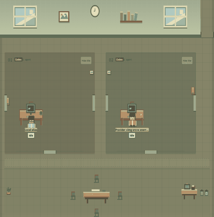
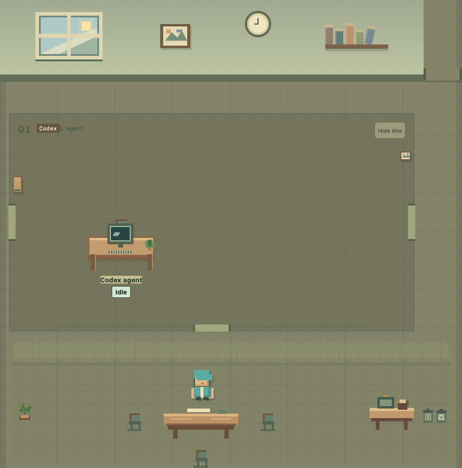
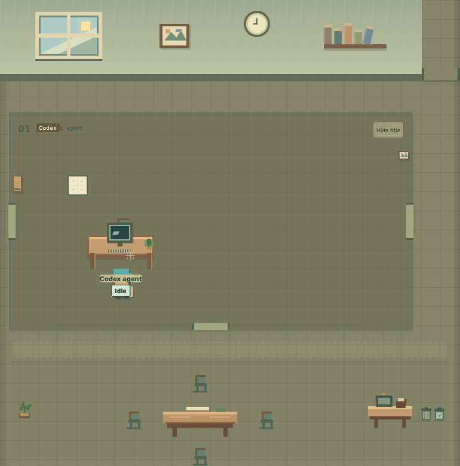
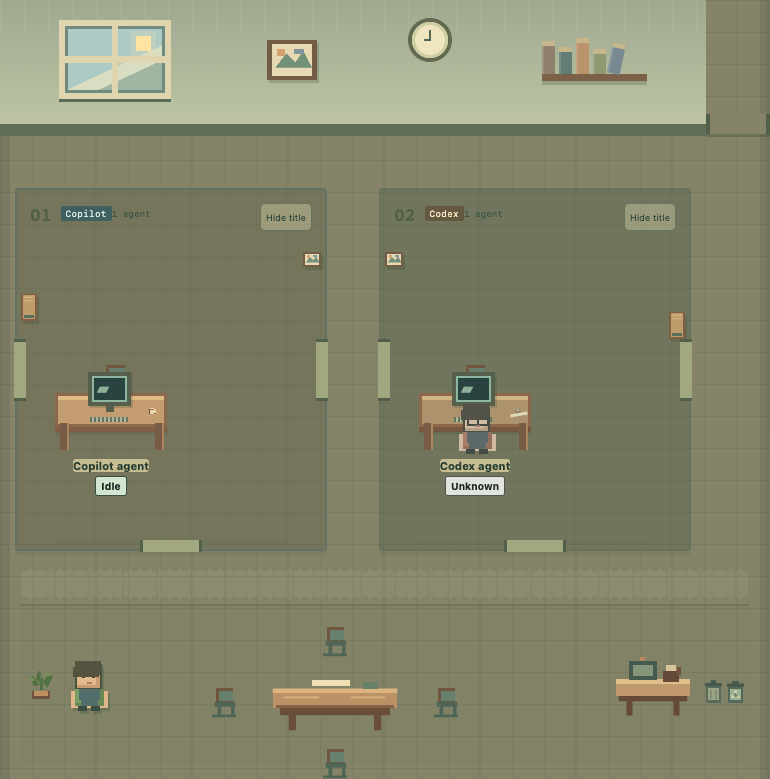
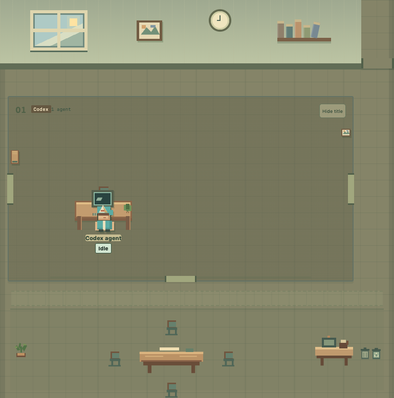
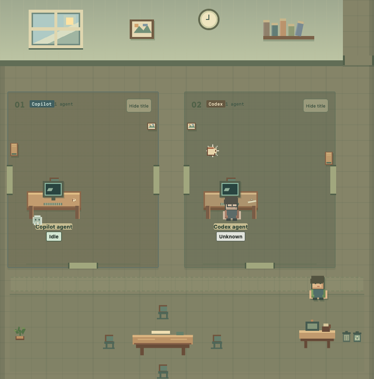
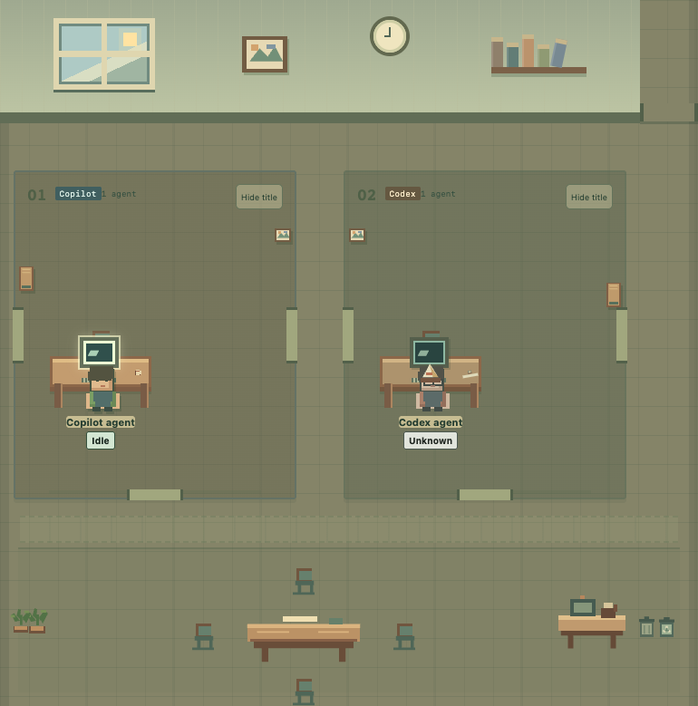

# Pixel Agents Canvas

**A tiny pixel-art office for real, observed agent activity—and a little office sitcom around it.**

Follow the Copilot conversation hosting the canvas and, after explicit opt-in, metadata-only discovery of existing local Codex CLI threads. Provider-reported identities, relationships, statuses, freshness, and activity-feed entries are the facts. Coffee runs, books, paper hats, spiders, ghosts, and chat bubbles are office fiction: they never start work, invent coworkers, or change the factual feed.

## A few tiny office stories

The office is easier to get to know through its favorite side quests. These are **real captures of the production renderer using deterministic synthetic fixtures**—not live agent activity. The badges and activity feed remain the facts; the antics stay fiction.

| **Coffee quest** | **A bookish pause** | **Spider inspection** |
|:---:|:---:|:---:|
| <a href="docs/images/readme/coffee-route.gif"></a><br>A real capture of the two-second production walk animation; the coffee station is single-user. | <a href="docs/images/readme/reading-break.png"></a><br>A character takes a seat at the four-chair table; the book can stay until someone tidies it. | <a href="docs/images/readme/spider-cleanup.png"></a><br>A tiny spider leaves a web; the character can clean it when it returns to that desk. |
| **Plant care** | **A paper-hat cameo** | **A quiet little ghost story** |
| <a href="docs/images/readme/plant-care.png"></a><br>A soft bit of office fiction, not a work-status change. | <a href="docs/images/readme/paper-hat.png"></a><br>The hat is a brief gag, not a saved appearance, role, or activity state. | <a href="docs/images/readme/quiet-ghost.png"></a><br>A ghost is not proof a session ended; only explicit provider-reported closure gets the factual “Session ended” marker. |

**The monitor effect uses an existing screen.** No bonus monitor appears, and a soft glow is not a real error.

<p align="center"><a href="docs/images/readme/monitor-glow.png"></a></p>

Want to see the whole cast of poses and props? Contributors can jump between named frames, step backward or forward, or opt in to **Play Frames** in the [local scenario gallery](dev/office-demo/README.md). It exercises the production renderer with deterministic synthetic fixtures; it is not a hosted sample feed and never connects to real agents.

## Set up shop in the GitHub Copilot App

In the GitHub Copilot App, use its installation-by-URL flow with the canonical [GitHub Folder URL](https://github.com/BPHvZ/pixel-agents-canvas/tree/main/.github/extensions/pixel-agents-canvas), which targets the canvas on `main`. A compatible Gist URL is an optional import format, but the project does not maintain a Gist mirror.

New imports from `main` use the latest merged code, which may not yet be part of a published source release. These instructions cover initial installation only: automatic updates, reinstallation behavior, and updates tied to source releases are unspecified. See the [release guide](docs/releasing.md) for the separate tagged source-release process.

## A preview window: VS Code

VS Code Canvas support is a preview and may change. For the preview checkout workflow, open this checkout as a trusted project, enable project extensions, reload them using the host's supported reload operation (or restart its session), then ask the agent to open **Pixel Agents Office**. This is not a finalized installation path. The canvas ID is `pixel-agents-canvas`; no VSIX package is supplied.

The runtime resolves the SDK for `.github/extensions/pixel-agents-canvas/extension.mjs`; users do not install an SDK package or run a separate dashboard server. A paid GitHub Copilot subscription is not a product prerequisite: the hosting Copilot harness can use the user's supported custom model route. A host may still require GitHub sign-in. The harness/activity source remains distinct from model vendor and billing route.

## The buttons behind the bustle

The office may be full of tiny side quests; the controls keep the useful facts in focus.

- Copilot reports only the hosting conversation and provider-identified subagents observed after the extension joined. It cannot enumerate unrelated Copilot chats. Select a character or roster entry by mouse or keyboard to see factual identity, activity, freshness, parent relationship, and last turn outcome where supplied.
- **Enable local Codex** is separate explicit opt-in to launch the installed Codex CLI app-server. The adapter discovers existing threads metadata-first, paginates active/archived listings with `useStateDbOnly`, and uses turns-excluded resume for live notifications. It never creates a thread or starts a model turn. **Disable local Codex** stops only the canvas-owned source connection/child, not a user's coding agent. Discovery retries while enabled; **Refresh** retries immediately.
- Source coverage explains unsupported, unavailable, connected-empty, stale, and disconnected conditions. Cross-session navigation is intentionally unavailable without a supported host/provider route. Stale observations never imply completion.
- **Hide all session titles** and each cluster's title control hide text only. Titles can contain sensitive user content; their derived fictional topic motifs remain visible, as the controls explain.
- **Show ended agents** includes explicitly ended workers/current-run ended clusters. A completed turn, archived thread, missing event, or Codex runtime unload does not mean a session ended. Codex does not currently expose a reliable persisted-session end signal through this adapter; it therefore does not fabricate departure/haunting on `thread/closed`.
- Customize a selected character's local nickname, palette, outfit, accessory, and desk prop. Nicknames are aliases; provider name/role stay available. Reset restores the deterministic identity-based look.
- **Office vignettes** and **Character dialogue** are independent fictional presentation controls. Authored idle-only social scenes, props, motifs, and voice flavor are labeled fiction and never enter the factual activity feed. Real work interrupts incompatible scenes. Props remain in the open instance until visibly tidied; closing the actual instance resets that office world. Hiding a panel or reopening the same instance preserves it. Reduced-motion preferences retain readable/static alternatives.

Agent-facing actions are `list_agents`, `enable_codex`, `disable_codex`, and `refresh_codex`. Each takes `{}`. The read-only list action deliberately omits private titles and appearance preferences.

## The serious bits: coverage and privacy

Codex CLI **0.163.0** is the currently live-tested protocol version. A locally installed/authenticated CLI is required; a ChatGPT subscription alone does not guarantee CLI access. An incompatible/missing CLI or unavailable state database reports unavailable rather than falling back to transcripts/history files. Copilot coverage depends on documented SDK session events, not model route or private host APIs.

The app-server uses local stdio; the adapter does not inspect credential/config files or open a remote provider listener. It drops Codex `preview`, transcript turns, paths, and unapproved payload fields before they reach the dashboard. Copilot content fields (prompts, responses, tool arguments/results, and source content) are ignored. Provider names/titles may still contain sensitive text. This is source-level minimization, not a guarantee that a host, proxy, runtime, or model provider never logs/transmits conversation content. Prompt summarization is unavailable in V1.

Factual activity/feed and per-open-instance office fiction stay in memory, not disk history. Private presentation preferences use versioned records under `extension-data/pixel-agents-canvas/<workspace-hash>/` in `COPILOT_HOME` exactly when supplied, otherwise `~/.copilot`. Workspace and identity keys are hashed into filenames. Only user-selected appearance/display settings persist. Records are validated on read and replaced atomically; corrupt/unrecognized records are reported, never automatically overwritten. Distinct identity writes are independent; settings/same-identity writes are last-writer-wins, not a multi-record transaction.

## When the office gets quiet: troubleshooting and verification

- Missing canvas: verify project trust, extension support and Canvases availability in the current host, then reload project extensions. Supported desktop session types differ; browser-only hosts cannot spawn Codex processes.
- Wrong/old actions or appearance: reload the project extension, not just its browser page. Capability discovery should show the four actions above, with no thread-creation action.
- Codex unavailable/stale: check the local CLI/version and database availability, inspect the generic coverage status, then refresh or disable/re-enable. No prompt/model request is needed to test discovery.
- Preference error: preserve the private storage directory and inspect its format/permissions locally. The extension will not repair corrupt data silently; do not paste private settings/session logs into issues.
- Facts differ from animation: badges, timestamps, coverage and the observed feed are authoritative; captions/scenes are fictional. Unknown/stale agents are not eligible for idle scenes.

The current VS Code canvas and an isolated real CLI/SDK runtime have passed open/action/reopen checks; synthetic HTTP/browser fixtures exercise the UI and scale without inventing product activity. Latest Copilot App visual review and broader accessibility/release checks remain explicit in [implementation progress](docs/implementation-progress.md). Earlier Phase 0 evidence does not validate every subsequent code revision.

## For contributors: keep the tiny office shipshape

Use Node.js 24 (CI) or a compatible version listed in `package.json`:

```bash
npm ci
npm run check
```

The check runs zero-warning ESLint, strict TypeScript over runtime-compatible JavaScript/custom declarations (no explicit/implicit `any` or unchecked index access), and behavioral/policy regressions. Unknown JSON/protocol inputs are validated before use. Tooling dependencies live only at the root; the host injects the SDK, and the local type projection does not replace runtime verification. Browser modules are checked separately from HTML.

Optional real-browser regressions require Python Playwright and local Google Chrome, installed separately if needed:

```bash
python .github/extensions/pixel-agents-canvas/test/office-ui.browser.py
```

Tests use synthetic metadata and temporary loopback servers, and clean up owned helpers. They never start a model turn or read real transcript content. New behavior must follow its accepted ADR and update the plan and progress tracker after each slice.

See [the release guide](docs/releasing.md) for how main-branch merges create a rolling GitHub source-release draft. Publishing a GitHub release does not make the canvas installable through a marketplace.

## Building with a little help from agents

[AGENTS.md](AGENTS.md) is the shared, tool-agnostic entry point. [The extension guide](.github/extensions/pixel-agents-canvas/AGENTS.md) adds SDK, renderer, storage, and lifecycle guidance for that subtree. These point to the plan, glossary, ADRs, and verified progress rather than replacing them.

Two project-owned skills use the portable `SKILL.md` format under `.agents/skills/`:

- [canvas-development](.agents/skills/canvas-development/SKILL.md): implement and verify canvas/UI/action/lifecycle changes.
- [canvas-provider-validation](.agents/skills/canvas-provider-validation/SKILL.md): validate provider discovery, events, privacy, and process recovery.

Agents that support skill discovery can load the relevant workflow on demand. Otherwise, read its linked file directly; no slash-command support, specific editor, model configuration, or vendor-specific agent tools are required. Other locally installed skill bundles are not required by this repository's workflow.
